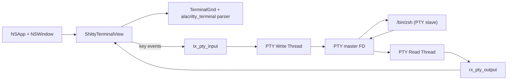

# Shitty

```
        _            _       _     _        _          _    _        _
       / /\         / /\    / /\  /\ \     /\ \       /\ \ /\ \     /\_\
      / /  \       / / /   / / /  \ \ \    \_\ \      \_\ \\ \ \   / / /
     / / /\ \__   / /_/   / / /   /\ \_\   /\__ \     /\__ \\ \ \_/ / /
    / / /\ \___\ / /\ \__/ / /   / /\/_/  / /_ \ \   / /_ \ \\ \___/ /
    \ \ \ \/___// /\ \___\/ /   / / /    / / /\ \ \ / / /\ \ \\ \ \_/
     \ \ \     / / /\/___/ /   / / /    / / /  \/_// / /  \/_/ \ \ \
 _    \ \ \   / / /   / / /   / / /    / / /      / / /         \ \ \
/_/\__/ / /  / / /   / / /___/ / /__  / / /      / / /           \ \ \
\ \/___/ /  / / /   / / //\__\/_/___\/_/ /      /_/ /             \ \_\
 \_____\/   \/_/    \/_/ \/_________/\_\/       \_\/               \/_/
```

A tiny terminal emulator in Rust. Uses alacritty_terminal for parsing, a PTY for the shell,
and a native AppKit renderer on macOS.

## Quick Start

```bash
cargo run
```

Other useful commands:

```bash
cargo build
cargo build --release
cargo clippy
cargo fmt
cargo test                    # unit + e2e (vtebench workloads, vim TUI)
```

The e2e suite needs the vtebench submodule: `git submodule update --init`.

Binary output: `target_local/` (see `.cargo/config.toml`).

## Releases

`.github/workflows/release.yml` publishes `Shitty.app` (Apple Silicon) as a `.zip`
and a `.dmg`, each with a SHA-256 file, on the GitHub Releases page. Every release
runs the full CI suite first.

- **Official:** bump `version` in `Cargo.toml`, merge to `main`, then
  `git tag v0.2.0 && git push origin v0.2.0`. The tag must match `Cargo.toml`.
- **Nightly:** built from `main` every day at 03:17 UTC as the rolling `nightly`
  pre-release; skipped when `main` has not changed. Run it now with
  `gh workflow run release.yml` (add `-f force=true` to rebuild an unchanged `main`).

To package locally: `tools/package-macos.sh 0.1.0` (writes to `dist/`).
Builds are ad-hoc signed, not notarized: open the app the first time with right-click > Open.

## Features

- ANSI/VT parsing via `alacritty_terminal` with a cell grid model.
- PTY-backed shell (`/bin/zsh`) with proper resize signaling.
- ANSI 16-color, xterm 256-color, and truecolor RGB support.
- Wide-character handling and underline rendering.
- Cursor rendering with inverse cell colors and DECSCUSR shape support.
- 1000-row scrollback with a scrollbar and mouse-wheel scrolling.
- Mouse text selection with clipboard copy/paste (⌘C/⌘V, ESC clears selection).
- Font zoom (⌘+/⌘−/⌘0) and IME composition support.
- macOS AppKit renderer with native key handling.
- Nerd Font monospace rendering (bundled fonts in `assets/`).

## Architecture


### Core Data Flow



## Project Layout

- `src/lib.rs`: library root exposing the `mac_app` module.
- `src/main.rs`: binary entry point calling `shitty::mac_app::run()`.
- `src/mac_app/`: native AppKit UI — `app.rs` (bootstrap, menu, window),
  `view/` (terminal view, split by component), `font.rs` (font loading).
- `src/mac_app/view/`: `mod.rs` (module wiring), `terminal_view.rs` (NSView
  subclass, events, IME), `state.rs` (view-wide state), `tabs.rs` (tab list and
  tab commands), `tab_bar.rs` (tab strip drawing and hit testing),
  `scrollbar.rs` (scrollbar and scrolling), `renderer.rs` (cells, cursor,
  selection, marked text), `resize.rs` (debounced resize reflow),
  `geometry.rs` (bounds ↔ grid math), `ime.rs` (composition state), `wake.rs`
  (PTY event bridge).
- `src/terminal/mod.rs`: terminal module exports.
- `src/terminal/grid.rs`: alacritty_terminal parser wrapper and grid access.
- `src/terminal/color.rs`: ANSI/xterm color mapping.
- `src/terminal/keymap.rs`: key event translation (AppKit).
- `src/terminal/pty.rs`: PTY session lifecycle, resize handling, and IO threads.
- `src/terminal/resize.rs`: resize debounce coalescing (grid + PTY resized together).
- `src/terminal/selection.rs`: line-based text selection and extraction.

## Notes

- Rendering is event-driven: PTY output is coalesced on the main run loop
  (8ms debounce) and redraws go through `setNeedsDisplay`/`drawRect`.
- Window resizes are debounced for 150ms, then applied to the grid and PTY together.
- Resizes propagate through TIOCSWINSZ and SIGWINCH to keep shells happy.

## Build Requirements

- Rust 2024 edition (see `Cargo.toml`).
- macOS-only build; uses objc2 + AppKit frameworks (no extra setup required).
