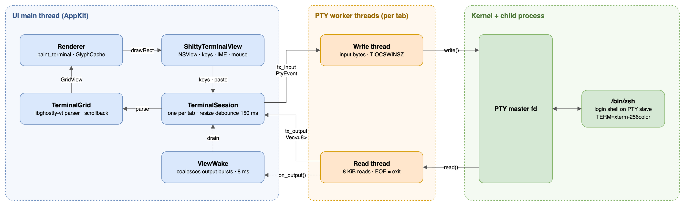

# Shitty

 *A tiny native macOS terminal emulator written by <a href="https://github.com/lixiao189">@lixiao189</a> and implemented in <a href="https://www.rust-lang.org/">Rust</a>, with VT parsing by <a href="https://github.com/Uzaaft/libghostty-rs">libghostty-vt</a>*

It draws with AppKit, parses with Ghostty's VT engine, and runs `zsh` on a real PTY in every tab.

<br clear="left">

## Installation

Download `Shitty.app` (Apple Silicon) from the
[Releases page](https://github.com/lixiao189/shitty/releases):

* **Stable:** tagged `vX.Y.Z` releases.
* **Nightly:** the rolling [`nightly`](https://github.com/lixiao189/shitty/releases/tag/nightly)
  pre-release, rebuilt from `main` every day.

Each release ships a `.zip` and a `.dmg`, each with a SHA-256 file. Builds are
ad-hoc signed and not notarized, so open the app the first time with
right-click → **Open**.

### Building from source

You need Rust (2024 edition) on macOS. Zig 0.17 is needed to build
libghostty-vt, but you don't have to install it: `tools/zig` downloads a pinned,
checksum-verified copy into `~/.cache/shitty/zig/` on the first build. Export
`ZIG` to use your own.

```bash
git clone https://github.com/lixiao189/shitty.git
cd shitty
cargo run --release
```

Build output goes to `target_local/`. To package a local `Shitty.app`, `.zip` and
`.dmg` into `dist/`, run `tools/package-macos.sh 0.1.0`.

## Features

* VT/ANSI parsing by `libghostty-vt`: 16-color, xterm 256-color and truecolor,
  wide characters, underlines, and DECSCUSR cursor shapes.
* Tabs, each with its own login shell started in `$HOME` with `TERM`, `COLORTERM`
  and `LANG` set, so it behaves the same when launched from Finder or the Dock.
* 1000 rows of scrollback with a scrollbar and mouse-wheel scrolling.
* Mouse selection with clipboard copy and paste (⌘C / ⌘V, Esc clears).
* Font zoom (⌘+ / ⌘− / ⌘0), IME composition, and a bundled Monaco Nerd Font.
* Color themes from the **View** menu, saved to `~/.config/shitty/config.toml`
  (override with `SHITTY_THEME` or `SHITTY_CONFIG`).

## Architecture



The UI thread owns every session; the two PTY threads per tab only move bytes.
Output bursts are coalesced for 8 ms into one drain on the main run loop, and a
window resize is applied to the grid and the PTY together once the size has been
stable for 150 ms, so output is never parsed at a width it wasn't generated for.

The diagram source is [`assets/architecture.drawio`](assets/architecture.drawio);
edit it in [draw.io](https://www.drawio.com/) and re-export the PNG.

## Contributing

`main` is protected, so changes go through a pull request. CI runs the same three
checks you can run locally:

```bash
cargo fmt --check
cargo clippy --all-targets -- -D warnings
cargo test                     # unit tests + e2e (vtebench workloads, Vim)
```

The e2e suite needs the vtebench submodule: `git submodule update --init`.
See [`CLAUDE.md`](CLAUDE.md) for the module layout and conventions.

## Getting help

Use the [GitHub issue tracker](https://github.com/lixiao189/shitty/issues) to see
if someone else has hit the same problem, or to file a new one.
