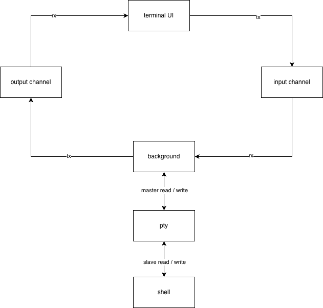
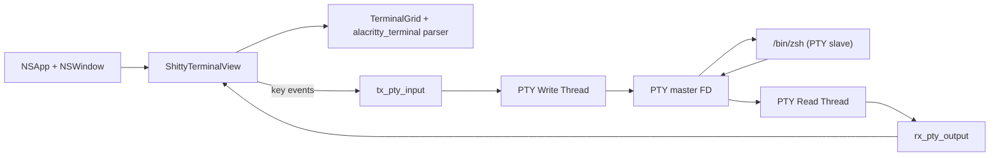

# Shitty

```
        _            _       _     _        _          _    _        _
       / /\         / /\    / /\  /\ \     /\ \       /\ \ /\ \     /\_\
      / /  \       / / /   / / /  \ \ \    \_\ \      \_\ \\ \ \   / / /
     / / /\ \__   / /_/   / / /   /\ \_\   /\__ \     /\__ \\ \ \_/ / /
    / / /\ \___\ / /\ \__/ / /   / /\/_/  / /_ \ \   / /_ \ \\ \___/ /
    \ \ \ \/___// /\ \___\/ /   / / /    / / /\ \ \ / / /\ \ \\ \ \_/
     \ \ \     / / /\/___/ /   / / /    / / /  \/_// / /  \/_/ \ \ \
 _    \ \ \   / / /   / / /   / / /    / / /      / / /         \ \ \
/_/\__/ / /  / / /   / / /___/ / /__  / / /      / / /           \ \ \
\ \/___/ /  / / /   / / //\__\/_/___\/_/ /      /_/ /             \ \_\
 \_____\/   \/_/    \/_/ \/_________/\_\/       \_\/               \/_/
```

A tiny terminal emulator in Rust. Uses alacritty_terminal for parsing, a PTY for the shell,
and a native AppKit renderer on macOS.

## Quick Start

```bash
cargo run
```

Other useful commands:

```bash
cargo build
cargo build --release
cargo clippy
cargo fmt
```

Binary output: `target_local/` (see `.cargo/config.toml`).

## Features

- ANSI/VT parsing via `alacritty_terminal` with a cell grid model.
- PTY-backed shell (`/bin/zsh`) with proper resize signaling.
- ANSI 16-color, xterm 256-color, and truecolor RGB support.
- Wide-character handling and underline rendering.
- Cursor rendering with inverse and custom cursor color support.
- macOS AppKit renderer with native key handling.
- Nerd Font monospace rendering (bundled fonts in `assets/`).

## Architecture



### Core Data Flow



## Project Layout

- `src/main.rs`: macOS AppKit entry point.
- `src/mac_app/`: native AppKit UI — `app.rs` (bootstrap, menu, window),
  `view.rs` (terminal view, rendering, IME), `font.rs` (font loading).
- `src/terminal/mod.rs`: terminal module exports.
- `src/terminal/grid.rs`: alacritty_terminal parser wrapper and grid access.
- `src/terminal/color.rs`: ANSI/xterm color mapping.
- `src/terminal/keymap.rs`: key event translation (AppKit).
- `src/terminal/pty.rs`: PTY session lifecycle, resize handling, and IO threads.

## Notes

- The AppKit path uses an NSTimer to drive render updates at 120Hz.
- Resizes propagate through TIOCSWINSZ and SIGWINCH to keep shells happy.

## Build Requirements

- Rust 2024 edition (see `Cargo.toml`).
- macOS-only build; uses objc2 + AppKit frameworks (no extra setup required).
